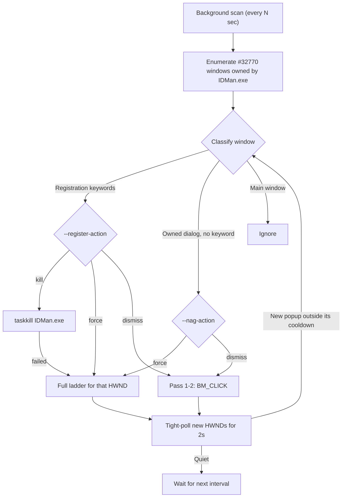

<div align="center">


<br/>

[](#)
[](#)
[](#)
[](#)

<p align="center">
  <b>A high-performance, non-intrusive background daemon that automatically dismisses Internet Download Manager (IDM) popups, nag screens, and registration reminders.</b>
  <br />
  <i>Preserves your downloads. Closes popups in parallel. Speaks IDM's language. Zero third-party dependencies.</i>
</p>

</div>

---

##  Key Features

-  **Zero Download Interruption**: Targets **only** `#32770` dialog windows owned by `IDMan.exe`. The core engine and active download threads are completely untouched.
-  **Per-class actions**: Registration dialogs follow `--register-action`. Ordinary nags follow `--nag-action`. One batch can dismiss a nag with buttons while force-closing a registration dialog.
-  **Parallel batch escalation**: Every popup in the batch is signaled together. Button passes always run. The Win32 message ladder runs only for windows whose action is `force`.
-  **Per-window cooldown**: A dialog that was just tried is skipped for `--cooldown` seconds (default **2.0**). A new HWND is eligible immediately, so a fresh popup is not frozen by an older one.
-  **13 languages**: Built-in registration keywords and dismiss labels for English, Spanish, Portuguese, Russian, French, German, Arabic, Vietnamese, Chinese (Simplified and Traditional), Turkish, Indonesian, and Persian. Accelerator markers (`&`, `取消(&C)`) and Unicode case-folding are stripped before matching.
-  **Clean shutdown**: Ctrl+C / `SIGINT` / `SIGBREAK` sets one event that wakes the scan sleep, the sibling tight-poll, and the console keyboard thread.

---

##  Architecture &amp; Workflow



Classification reads the title and child control text. Hints are matched as folded substrings. Button clicks require the whole label to match after the same folding, so a short label like `No` does not click `Not now`.

Folding is `NFKC` → strip Win32 accelerators → drop bidi/zero-width marks and Arabic tatweel → `casefold` → drop combining marks (so `Más` and `Mas`, `İptal` and `iptal` meet). Chinese, Arabic, and Persian letters are compared as themselves.

### Escalation ladder

Popups in one scan are closed together. After each pass the script forgets windows that have already gone.

| Stage | Action | Mechanism | When it runs |
|:---:|:---|:---|:---|
| **1** | Primary dismiss button | `BM_CLICK` | Always. Prefers longer labels such as "Remind me later" / "稍后提醒" / "Напомнить позже" before a bare "No" or "OK". |
| **2** | Short fallback button | `BM_CLICK` | Always. Localized No / Cancel / Close / OK (`Cancelar`, `Annuler`, `Abbrechen`, `Отмена`, `取消`, `إلغاء`, …). |
| **3** | Direct No | `WM_COMMAND` `IDNO` | `force` only |
| **4** | Direct Cancel | `WM_COMMAND` `IDCANCEL` | `force` only |
| **5** | System close | `WM_SYSCOMMAND` `SC_CLOSE` | `force` only |
| **6** | Queue close | `WM_CLOSE` | `force` only |

> [!NOTE]
> `dismiss` stops after the button passes. It does not post `WM_CLOSE`.
> `force` climbs the full ladder.
> `kill` (registration only) calls `taskkill /F /IM IDMan.exe`. If that fails, those registration dialogs still take the force ladder. Nags in the same batch keep `--nag-action`.

A manual `close` uses the same per-class rules. It does not taskkill; type `kill` for that.

### Cooldown

Cooldown is stored per HWND, not as a global freeze. Closing one dialog does not delay a different dialog that appears a moment later. The default is **2.0 seconds**. The 2 second sibling poll after a close also respects that per-window timer, and it stops early on Ctrl+C.

### Shutdown

`Ctrl+C` raises `SIGINT` (and `Ctrl+Break` raises `SIGBREAK` when Python exposes it). The handler sets a shared `threading.Event` and interrupts the main thread once. The monitor waits on that event instead of a blind `sleep`, the tight-poll uses the same event, and a console keyboard thread polls `msvcrt` so it can exit without sitting inside `readline`. A second Ctrl+C during cleanup is ignored so the final stats line still prints. `pythonw` has no console; stop that process with Task Manager or `Stop-Process`.

### Win32 types

`HWND`, `WPARAM`, and `LPARAM` are pointer-width (`c_void_p`, `c_uint64`, `c_int64` on 64-bit; 32-bit equivalents on 32-bit). `ctypes.c_long` is 32-bit even on 64-bit Windows, so it is not used for `LPARAM`. `BOOL` and `DWORD` stay 32-bit, which is what the Win32 ABI uses for those. Startup checks the widths and refuses to run if they do not match the process pointer size.

---

##  Requirements

- **Operating System:**  Windows 10 / 11 (64-bit or 32-bit)
- **Runtime:**  Python 3.8 or newer
- **External Dependencies:** **None** (100% native standard library via `ctypes`)

---

##  Usage

### 1. Interactive console mode

```powershell
python idm_popup_killer.py
```

#### Interactive commands

| Command | Shortcut | Description |
|:---|:---:|:---|
| `close` | `c` or `<Enter>` | Scan and close visible popups using each window's own action |
| `status` | `s` | Print active popups, handles, the action each one would take, and stats |
| `kill` | — | Terminate `IDMan.exe` immediately. This typed command does not require `--allow-process-kill` |
| `quit` | `q` | Stop the monitor and exit |

On a real console, typed characters are echoed by the reader thread. Paste and arrow-key editing are not replayed; use a normal launch under `cmd` or PowerShell if you only need short commands.

---

### 2. Silent background mode

```powershell
pythonw idm_popup_killer.py --log-file "%USERPROFILE%\Desktop\idm_popups.log"
```

To stop a background `pythonw` process later:

```powershell
Stop-Process -Name pythonw -Force
```

---

##  Command-Line Options

```
usage: idm_popup_killer.py [-h] [--interval INTERVAL] [--cooldown COOLDOWN]
                           [--batch-delay BATCH_DELAY]
                           [--register-action {dismiss,force,kill}]
                           [--nag-action {dismiss,force}]
                           [--allow-process-kill] [--dry-run] [--debug]
                           [--log-file LOG_FILE] [--no-echo]
                           [--hints-file HINTS_FILE]
                           [--extra-hints EXTRA_HINTS]
```

### Detailed flag reference

| Flag | Default | Description |
|:---|:---:|:---|
| `--interval` | `2.0` | Seconds between background scans. |
| `--cooldown` | `2.0` | Per-HWND delay before that same window is tried again. Other popups are not held back. `0` retries on the next scan. |
| `--batch-delay` | `0.15` | Seconds between escalation stages. |
| `--register-action` | `force` | Registration dialogs: `dismiss` (button clicks only), `force` (full message ladder), or `kill` (terminate `IDMan.exe`). |
| `--nag-action` | `dismiss` | Owned nag dialogs that did not match a registration keyword: `dismiss` or `force`. |
| `--allow-process-kill` | `False` | Required together with `--register-action kill`. |
| `--dry-run` | `False` | Log matches and do not click or post messages. |
| `--debug` | `False` | Log class, owner, child text, and per-window cooldown skips. |
| `--log-file` | `None` | Append UTF-8 log lines to this path. |
| `--no-echo` | `False` | Do not print log lines to the console. |
| `--hints-file` | `None` | JSON object that replaces the built-in lists. Keys: `register_hints`, `dismiss_buttons`, `fallback_buttons`. |
| `--extra-hints` | empty | Comma-separated extras applied after the hints file. `hint:` adds a registration keyword, `btn:` adds a button label, and an unprefixed token is added to both. |

`--register-action kill` without `--allow-process-kill` is rejected at startup.

---

##  Practical recipes

#### Fast dismissal

Default cooldown is already 2 seconds. This tightens the scan and the pause between passes:

```powershell
python idm_popup_killer.py --interval 1.0 --cooldown 0.5 --batch-delay 0.05
```

#### Registration force, nags stay on buttons

```powershell
python idm_popup_killer.py --register-action force --nag-action dismiss
```

#### Dry run

```powershell
python idm_popup_killer.py --dry-run --debug
```

#### Buttons only, both classes

```powershell
python idm_popup_killer.py --register-action dismiss --nag-action dismiss
```

#### One extra keyword and one extra button

```powershell
python idm_popup_killer.py --extra-hints "hint:clave de licencia,btn:Recordarme más tarde"
```

#### Last-resort process kill

```powershell
python idm_popup_killer.py --register-action kill --allow-process-kill
```

---

##  Run automatically on Windows startup

### Option A: Startup folder

1. Press <kbd>Win</kbd> + <kbd>R</kbd>, type `shell:startup`, and press <kbd>Enter</kbd>.
2. Right-click in the folder → **New** → **Shortcut**.
3. Set the target to:

   ```cmd
   pythonw "C:\path\to\idm_popup_killer.py" --log-file "C:\path\to\idm_popups.log"
   ```

4. Name it `IDM Popup Killer` and finish the wizard.

### Option B: Scheduled task

```powershell
$Action = New-ScheduledTaskAction -Execute "pythonw.exe" -Argument "`"C:\path\to\idm_popup_killer.py`""
$Trigger = New-ScheduledTaskTrigger -AtLogOn
$Settings = New-ScheduledTaskSettingsSet -AllowStartIfOnBatteries -DontStopIfGoingOnBatteries -ExecutionTimeLimit 0
Register-ScheduledTask -TaskName "IDMPopupKiller" -Action $Action -Trigger $Trigger -Settings $Settings -Description "Runs IDM Popup Killer silently in background"
```

---

##  Safety

> [!IMPORTANT]
> **Active downloads are left alone.**
> The script checks the owning executable with `QueryFullProcessImageNameW` and only talks to `#32770` dialogs whose process name contains `idman`. The main IDM window is not a registration dialog and is not owned like a nag, so it is ignored. Messages are posted with `PostMessageW` (asynchronous). No hooks and no injected DLLs.

- **Process kill is opt-in.** `--register-action kill` will not run unless `--allow-process-kill` is also present. The interactive `kill` command is separate and always explicit.
- **Dismiss cannot escalate by accident.** A nag with `--nag-action dismiss` does not receive `IDNO`, `IDCANCEL`, `SC_CLOSE`, or `WM_CLOSE`, even when a registration dialog in the same batch is on `force`.

---

##  Languages and custom labels

Built-in coverage:

| Code | Registration hints (examples) | Dismiss labels (examples) |
|:---|:---|:---|
| `en` | register, unregistered, trial, serial | Remind me later, Not now, No thanks |
| `es` | registrar, no registrada, licencia | Recordar más tarde, Ahora no, Cancelar |
| `pt` | registrar, não registrada, licença | Lembrar mais tarde, Agora não, Fechar |
| `ru` | регистрац, незарегистрир, лиценз | Напомнить позже, Отмена, Нет |
| `fr` | enregistrer, non enregistr, licence | Rappeler plus tard, Annuler, Fermer |
| `de` | registrier, unregistriert, Testversion | Später erinnern, Abbrechen, Schließen |
| `ar` | تسجيل, غير مسجل, ترخيص | ذكرني لاحقا, إلغاء, إغلاق |
| `vi` | đăng ký, chưa đăng ký, giấy phép | Nhắc tôi sau, Hủy, Đóng |
| `zh-Hans` | 注册, 未注册, 试用 | 稍后提醒, 取消, 关闭 |
| `zh-Hant` | 註冊, 未註冊, 試用 | 稍後提醒, 取消, 關閉 |
| `tr` | kayıt ol, lisanssız, deneme | Daha sonra hatırlat, İptal, Kapat |
| `id` | belum terdaftar, beli sekarang | Ingatkan saya nanti, Batal, Tutup |
| `fa` | ثبت نام, خرید, مجوز | بعدا یادآوری کن, لغو, بستن |

Russian hints are stems (`регистрац`, `лиценз`) so the usual case endings still match. Latin accents are folded, so `Não` matches `nao`.

Add a label without editing the script:

```powershell
python idm_popup_killer.py --extra-hints "hint:registrar ahora,btn:Recordarme,Cerrar"
```

`Cerrar` has no prefix, so it is used both as a keyword and as a button. Prefer `hint:` / `btn:` when a word should only do one job. Commas separate tokens; a phrase that itself contains a comma belongs in a JSON file:

```json
{
  "register_hints": ["registrar ahora", "clave de licencia"],
  "dismiss_buttons": ["recordarme más tarde", "ahora no"],
  "fallback_buttons": ["cancelar", "cerrar"]
}
```

```powershell
python idm_popup_killer.py --hints-file .\idm_hints.json --extra-hints "btn:Más tarde"
```

The file replaces the lists it names. `--extra-hints` is applied after that, so it can put a personal label back on top of a full replacement. UTF-8 with or without a BOM is accepted.

The built-in tables still live in `idm_popup_killer.py` (`_LOCALES`, `_FALLBACK_GROUPS`) if you would rather change the source.

---

## ⚖️ Disclaimer &amp; License

- This utility only automates the dismissal of dialog popups. It does not patch, crack, alter binary files, or modify registry entries, nor does it provide paid functionality. If you use IDM regularly, consider purchasing an official license at [internetdownloadmanager.com](https://www.internetdownloadmanager.com/).
- Released under the [MIT License](https://opensource.org/licenses/MIT).
