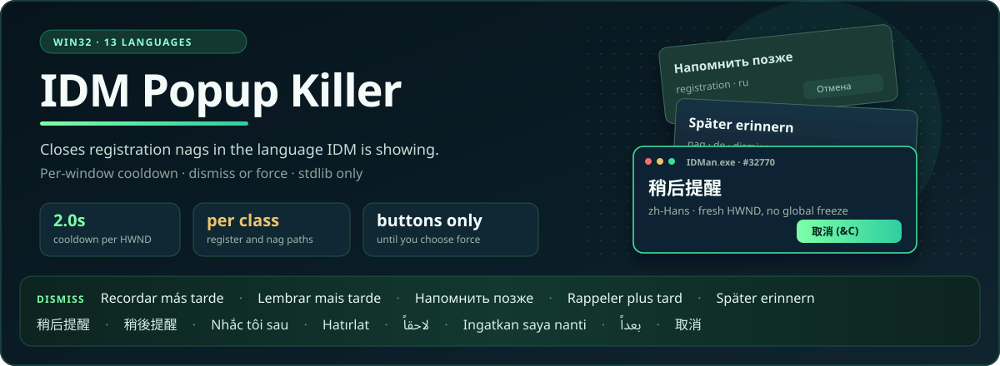
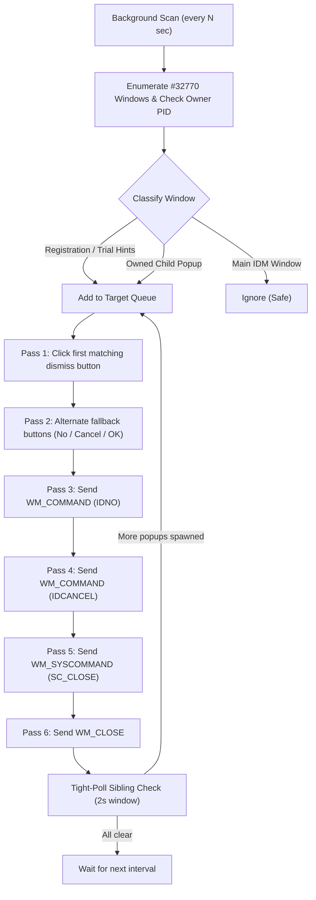

<div align="center">



<br/>

[](#)
[](#)
[](#)
[](#)

<p align="center">
  <b>A high-performance, non-intrusive background daemon that automatically dismisses Internet Download Manager (IDM) popups, nag screens, and registration reminders.</b>
  <br />
  <i>Preserves your downloads. Closes popups in parallel. Zero third-party dependencies.</i>
</p>

</div>

---

##  Key Features

-  **Zero Download Interruption**: Targets **only** `#32770` dialog windows owned by `IDMan.exe`. The core engine and active download threads are completely untouched.
-  **Parallel Batch Escalation**: Detects and dispatches dismissal signals to multiple popups simultaneously instead of clicking them one by one.
-  **Smart Classification**: Introspects child UI controls to distinguish between registration prompts, minor nag dialogs, and the main application window.
-  **Sibling Catching**: Tight-polls immediately after closing a dialog to instantly squash cascade popups that IDM spawns in response to dismissal.
-  **Ultra Lightweight**: Pure Python standard library using `ctypes` and Win32 messaging (`user32` / `kernel32`). Uses virtually zero CPU and minimal RAM.
-  **Unobtrusive**: Run interactively in a console or silently in the background with `pythonw`.

---

##  Architecture &amp; Workflow



### 6-Stage Escalation Ladder

Popups are closed in parallel batches. At each stage, the script checks if windows are still open before escalating further:

| Stage | Action | Mechanism | Notes |
|:---:|:---|:---|:---|
| **1** | Primary Dismiss Button | `BM_CLICK` | Clicks *"Remind me later"*, *"Not now"*, *"Later"*, *"Cancel"*, etc. |
| **2** | Alternate Button Fallback | `BM_CLICK` | Tries alternate buttons (*"No"*, *"Cancel"*, *"OK"*, *"Close"*) |
| **3** | Direct No Signal | `WM_COMMAND (IDNO)` | Sends the exact internal command triggered by pressing "No" |
| **4** | Direct Cancel Signal | `WM_COMMAND (IDCANCEL)` | Triggers dialog cancellation handler |
| **5** | System Window Close | `WM_SYSCOMMAND (SC_CLOSE)` | Invokes the standard window title bar close routine |
| **6** | Win32 Window Destroy | `WM_CLOSE` | Posts final graceful termination message to the dialog |

> [!NOTE]
> Stages 3–5 execute when `--register-action force` is active (default).

---

##  Requirements

- **Operating System:**  Windows 10 / 11 (64-bit or 32-bit)
- **Runtime:**  Python 3.8 or newer
- **External Dependencies:** **None** (100% native standard library via `ctypes`)

---

##  Usage

### 1. Interactive Console Mode
Run directly in PowerShell, Command Prompt, or Windows Terminal:

```powershell
python idm_popup_killer.py
```

#### Interactive Commands
While running in console mode, press any of the following keys:

| Command | Shortcut | Description |
|:---|:---:|:---|
| `close` | `c` or `<Enter>` | Immediately scan and close all visible popups |
| `status` | `s` | Print active popups, window handles, and total closure statistics |
| `kill` | — | Force terminate `IDMan.exe` (requires `--allow-process-kill`) |
| `quit` | `q` | Stop the monitor and exit cleanly |

---

### 2. Silent Background Mode (No Terminal Window)
Use `pythonw` to run the script silently in the background with optional file logging:

```powershell
pythonw idm_popup_killer.py --log-file "%USERPROFILE%\Desktop\idm_popups.log"
```

To stop a background `pythonw` process later:
```powershell
Stop-Process -Name pythonw -Force
```

---

##  Command-Line Options

```
usage: idm_popup_killer.py [-h] [--interval INTERVAL] [--cooldown COOLDOWN]
                           [--batch-delay BATCH_DELAY]
                           [--register-action {dismiss,force,kill}]
                           [--nag-action {dismiss,force}] [--allow-process-kill]
                           [--dry-run] [--debug] [--log-file LOG_FILE] [--no-echo]
```

### Detailed Flag Reference

| Flag | Default | Description |
|:---|:---:|:---|
| `--interval` | `2.0` | Time in seconds between periodic background scans. |
| `--cooldown` | `10.0` | Minimum delay in seconds between close operations to prevent thrashing. |
| `--batch-delay` | `0.15` | Delay in seconds between escalation stages (lower values close popups faster). |
| `--register-action` | `force` | Action for registration popups: `dismiss` (buttons only), `force` (full message escalation), or `kill` (terminates process). |
| `--nag-action` | `dismiss` | Action for general nag dialogs (`dismiss` or `force`). |
| `--allow-process-kill` | `False` | Safety interlock required if `--register-action kill` is selected. |
| `--dry-run` | `False` | Detect and log dialogs without sending any click or close messages. |
| `--debug` | `False` | Output detailed window fingerprints (HWNDs, child text, class names). |
| `--log-file` | `None` | Path to a file where timestamps and event logs should be appended. |
| `--no-echo` | `False` | Suppress console output (useful when logging exclusively to file). |

---

##  Practical Recipes

#### 🏎️ Aggressive &amp; Ultra-Fast Dismissal
Checks every second and executes passes with minimal delay:
```powershell
python idm_popup_killer.py --interval 1.0 --cooldown 2.0 --batch-delay 0.05
```

#### 🔍 Dry Run Inspection
Inspect what IDM popups are detected without taking any action:
```powershell
python idm_popup_killer.py --dry-run --debug
```

#### 🌿 Gentle Mode
Dismiss dialogs using button clicks only, avoiding direct Win32 command messaging:
```powershell
python idm_popup_killer.py --register-action dismiss --nag-action dismiss
```

---

##  Run Automatically on Windows Startup

To run IDM Popup Killer silently whenever you log in:

### Option A: Windows Startup Folder (Easiest)
1. Press <kbd>Win</kbd> + <kbd>R</kbd>, type `shell:startup`, and press <kbd>Enter</kbd>.
2. Right-click in the folder $\rightarrow$ **New** $\rightarrow$ **Shortcut**.
3. Set the target to:
   ```cmd
   pythonw "C:\path\to\idm_popup_killer.py" --log-file "C:\path\to\idm_popups.log"
   ```
4. Click **Next**, name it `IDM Popup Killer`, and click **Finish**.

### Option B: PowerShell Scheduled Task
Run this once in PowerShell to register a persistent logon task:

```powershell
$Action = New-ScheduledTaskAction -Execute "pythonw.exe" -Argument "`"C:\path\to\idm_popup_killer.py`""
$Trigger = New-ScheduledTaskTrigger -AtLogOn
$Settings = New-ScheduledTaskSettingsSet -AllowStartIfOnBatteries -DontStopIfGoingOnBatteries -ExecutionTimeLimit 0
Register-ScheduledTask -TaskName "IDMPopupKiller" -Action $Action -Trigger $Trigger -Settings $Settings -Description "Runs IDM Popup Killer silently in background"
```

---

##  Safety &amp; Architecture Guarantees

> [!IMPORTANT]
> **Active Downloads Are Safe**  
> `idm_popup_killer` verifies process ownership with `QueryFullProcessImageNameW` and targets only dialog windows (`#32770`). It explicitly avoids the main IDM download manager window and never terminates `IDMan.exe` during standard operation.

- **Process Verification**: Only windows belonging to a process whose executable matches `idman` are inspected.
- **Window Isolation**: The main application window has no parent owner and lacks registration dialog text; it is filtered out immediately.
- **Fail-Safe Design**: No Windows hooks or DLL injections are used. All interactions rely strictly on non-blocking asynchronous Win32 message queues (`PostMessageW`).

---

##  Customization

If a future IDM release changes button labels or dialog wording, you can adapt the matcher arrays directly in [idm_popup_killer.py](file:///C:/Users/wyant/OneDrive/Desktop/TEST%20TRACKER/idm_popup_killer.py#L44-L53):

```python
REGISTER_HINTS = [
    "register", "buy now", "unregistered", "activate", "purchase",
    "license", "trial", "30-day", "30 day", "serial", "activation",
    "registration", "do you want to register",
]

DISMISS_BUTTONS = [
    "remind me later", "remind me", "later", "not now", "no thanks",
    "no", "close", "cancel", "dismiss", "ok",
]
```

---

## ⚖️ Disclaimer &amp; License

- This utility only automates the dismissal of dialog popups. It does not patch, crack, alter binary files, or modify registry entries, nor does it provide paid functionality. If you use IDM regularly, consider purchasing an official license at [internetdownloadmanager.com](https://www.internetdownloadmanager.com/).
- Released under the [MIT License](https://opensource.org/licenses/MIT).
